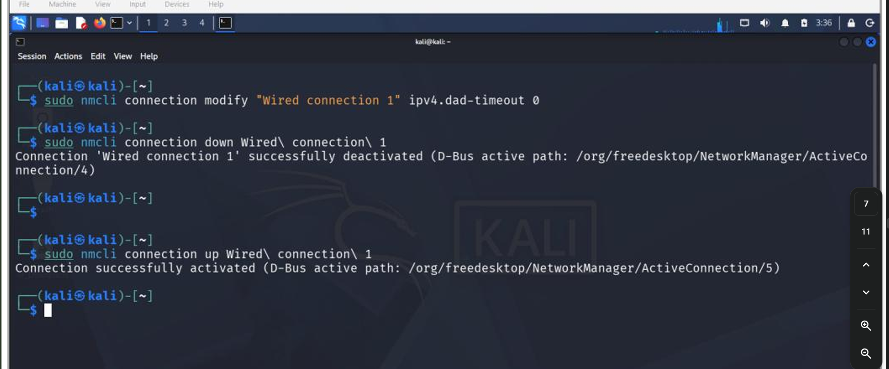

# cybersecurity-lab-setup-Networkwalks-week-1
A hands-on cybersecurity lab setup using Oracle VirtualBox and Kali Linux.

🔐 Cybersecurity & Ethical Hacking Lab Setup

📌 Project Overview

This project focuses on setting up a virtual cybersecurity testing lab using Oracle VirtualBox and Kali Linux for educational purposes and authorized security testing.

The lab assignment covers virtual machine configuration, custom NAT Network setup, IP addressing, shared folders, network connectivity, and VM snapshots.

🎯 Project Objectives

- Set up Oracle VirtualBox.
- Import Kali Linux as the testing machine.
- Configure a custom NAT Network using `10.0.0.0/24`.
- Configure Kali Linux with the planned IP address `10.0.0.2/24`.
- Enable clipboard sharing and drag-and-drop.
- Configure a shared folder with the host machine.
- Test internet connectivity and DNS resolution.
- Create a virtual machine snapshot for recovery.

🛠️ Tools & Technologies

- Oracle VirtualBox
- Kali Linux
- NAT Network
- IPv4 Networking
- DNS
- Virtual Machine Snapshots

🌐 Network Configuration

| Setting | Planned Configuration |
|---|---|
| Network Type | NAT Network |
| Subnet | `10.0.0.0/24` |
| Kali Linux IP | `10.0.0.2/24` |
| Purpose | Isolated cybersecurity practice lab with network access |

📚 Key Learning Areas

- Virtualization and virtual machine management
- NAT Network configuration
- IP addressing and subnetting
- Network connectivity troubleshooting
- Shared folders and clipboard integration
- Snapshot creation and recovery

---

# WEEK 1 – VIRTUAL CYBERSECURITY LAB SETUP

## Project Report

**Project:** Virtual Cybersecurity Lab Setup

**Objective:** Setting up a virtual lab environment for cybersecurity and ethical hacking practice.

📄 **Download Project Documentation:**

[View / Download Week 1 Project Report](./Week1_Virtual_Lab_Setup_Report.pdf)

---

## Project Screenshots

### Screenshot 1

### Screenshot 2

---

## Additional Images

### Image 1

### Image 2
.png)

### Image 3
.png)

---

⚠️ Disclaimer

This lab is intended for educational purposes and authorized cybersecurity testing only.

---

**Project:** Week 1 – Cybersecurity & Ethical Hacking Lab Setup  
**Platform:** Oracle VirtualBox  
**Testing Machine:** Kali Linux
